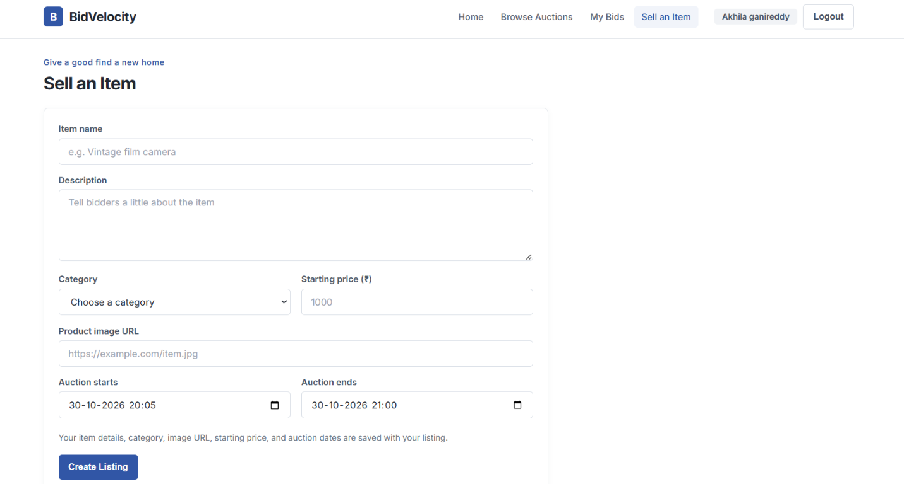

# BidVelocity

BidVelocity is an online auction marketplace. Users can browse listings, register and log in, place bids, track their bids, and create auction listings.

## Screenshots

### Home and featured auctions


### Create a listing



## Features

- Browse, search, filter, and sort auction listings
- Register and log in
- Place bids and view your bidding activity
- Create auction listings with a category, starting price, image URL, and start/end times
- Sample listings are shown when the API is unavailable

## Technology

- Frontend: HTML, CSS, and vanilla JavaScript
- Backend: Java 21, Spring Boot, and Spring Cloud
- Database: MySQL
- API routing: Spring Cloud Gateway

## Project layout

```text
frontend/                 Static web application
backend/
  EurekaServer/           Service registry (port 8761)
  APIGateway/             Frontend API entry point (port 9000)
  AuctionService/         Auction listings (port 9101)
  BiddingService/         Bids (port 9002)
  PaymentService/         Payments (port 9003)
  AuthService/            Registration and login (port 9004)
docs/screenshots/         README screenshots
```

## Run locally

### Prerequisites

- JDK 21
- MySQL running locally
- Maven installed for `PaymentService` (the other listed services include `mvnw.cmd`)
- Python or a static-file server of your choice to serve the frontend

The backend uses four MySQL databases, created automatically by the services:
`bidvelocity_auth`, `bidvelocity_auction`, `bidvelocity_bidding`, and `bidvelocity_payment`.
Set `DB_USERNAME` and `DB_PASSWORD` in each service's terminal before starting it. For example, in PowerShell:

```powershell
$env:DB_USERNAME = "root"
$env:DB_PASSWORD = "your-local-mysql-password"
```

The authentication service also needs a Base64-encoded signing key. Generate a temporary 256-bit key in PowerShell and keep it private:

```powershell
$env:JWT_SECRET = [Convert]::ToBase64String([Security.Cryptography.RandomNumberGenerator]::GetBytes(32))
```

Start each backend service in its own terminal, from its project directory. Start Eureka first, then the services and gateway:

```powershell
cd backend\EurekaServer\EurekaServer
.\mvnw.cmd spring-boot:run
```

Repeat with the following directories and commands:

| Service | Directory | Command |
|---|---|---|
| AuthService | `backend\AuthService\AuthService` | `.\mvnw.cmd spring-boot:run` |
| AuctionService | `backend\AuctionService\AuctionService` | `.\mvnw.cmd spring-boot:run` |
| BiddingService | `backend\BiddingService\BiddingService` | `.\mvnw.cmd spring-boot:run` |
| PaymentService | `backend\PaymentService\PaymentService` | `mvn spring-boot:run` |
| APIGateway | `backend\APIGateway\APIGateway` | `.\mvnw.cmd spring-boot:run` |

Set the database variables in every service terminal. Set `JWT_SECRET` in the AuthService terminal. To run the frontend, open a separate terminal:

```powershell
cd frontend
python -m http.server 5500
```

Then open <http://localhost:5500>. The frontend sends API requests to the gateway at `http://localhost:9000`.

